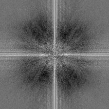
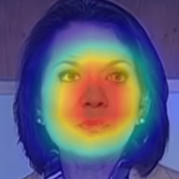

# 深度伪造检测 · 实验日志

> 课程设计过程记录。每次实验一节，固定写：**动机 → 改了什么 → 命令 → 结果 → 说明了什么 → 下一步**。
> 最后用 pandoc 转 LaTeX/Word，正文按学校模板排版。

---

## 0. 指标口径（先统一，避免后面各说各话）

| 指标 | 含义 | 在本项目里的用法 |
|---|---|---|
| AUC | 随机取一真一假，假图分数更高的概率；与阈值无关 | **选模型的主指标**，衡量排序能力 |
| F1 | 精确率与召回率的调和平均；依赖阈值 | 报告时**必须注明阈值** |
| TPR@FPR=1% | 误报控制在 1% 时能抓到多少假图 | 业务最关心的指标，单独列 |
| FPR | 真图被误判为假的比例 | 与 TPR 成对出现 |
| EER | 误报率 = 漏报率时的错误率 | 跨库对比常用 |

**阈值策略**：阈值只在验证集上定，写进 checkpoint；测试集、跨库都沿用，绝不重调。
`splits/val.csv` 用来定阈值和选模型，`test.csv` 只在最后用。

---

## 1. 数据

| 项 | 内容 |
|---|---|
| 主库 | FF++ C23（第三方镜像，1,000 真 + 6,000 假，6 种方法） |
| 抽样 | 400 个身份，每个 1 条真 + 2 条假（不同方法）→ 1,200 条视频 |
| 伪造方法 | Deepfakes / Face2Face / FaceSwap / NeuralTextures / FaceShifter 各 160 条；真 400 条 |
| 抽帧 | 2 fps，每条视频最多 20 帧，YuNet 裁最大人脸，256×256 |
| 帧数 | 训练 16,800 / 验证 3,569 / 测试 3,600（共约 2.4 万） |
| 划分 | 按身份 280 / 60 / 60，训练与测试身份零重叠 |
| 跨库 | Celeb-DF Test 图片 10,103 张，评测取平衡 1,000 真 + 1,000 假 |

**为什么按身份抽样/划分**：FF++ 的真视频 `000.mp4` 和假视频 `000_003.mp4` 是同一个人。
按帧随机划分会让同一个人的脸同时出现在训练和测试里（身份泄漏），指标虚高、跨库崩盘。

**已知缺口**：`DeepFakeDetection` 的视频 id 与真人视频对不上，未进入子集，因此是 5 种方法而非 6 种。

---

## 2. 实验记录

### E0 · 数据管线（2026-11-20）

- **目的**：得到可训练、可评测、无身份泄漏的数据。
- **做法**：按身份抽 400 个 → 抽帧 + YuNet 裁脸 → 按源视频 id 划分。
- **结果**：1,200 条视频（2.1 GB）→ 约 2.4 万张人脸图；划分 280/60/60 个身份。
- **结论**：管线可用；验证了训练/测试身份重叠为 0。
- **遗留**：DFD 未纳入；人脸检测失败约 1% 的帧（正常）。

### E1 · RGB 基线（8 epoch，训练时 100% 加退化）

**动机**：先要一个能跑通的基线，确认数据、训练、评测三条链路没问题。

**配置**

| 项 | 值 |
|---|---|
| 模型 | ResNet18（ImageNet 预训练）+ Linear(512→256) + Linear(256→2) |
| 输入 | 224×224，ImageNet 归一化 |
| 训练 | AdamW，lr=1e-4，wd=1e-4，cosine，batch=32，AMP |
| 增强 | 随机翻转；**每张图都**随机施加 1–2 种退化（JPEG 30–96 / 噪声 / 模糊 / 下采样 / 裁剪） |
| 选模型 | 按验证集 F1（在 FPR=1% 阈值下） |
| 耗时 | 约 30 秒/epoch，8 epoch 共 4 分钟 |

**命令**

```bash
python -m src.train --config configs/base.yaml --name baseline_rgb --rgb-only --epochs 8
```

**结果（best epoch = 5）**

| 数据 | AUC | F1 | 召回 | FPR | 阈值 | EER | TPR@FPR1% |
|---|---|---|---|---|---|---|---|
| FF++ 验证集 | 0.8628 | 0.4288 | 0.274 | 0.92% | 0.99935 | 0.219 | 0.274 |
| FF++ 测试集 | 0.8763 | 0.4167 | 0.265 | 1.67% | 0.99935 | 0.203 | 0.231 |
| FF++ 测试集（阈值 0.5） | 0.8763 | **0.8501** | 0.828 | **24.0%** | 0.5 | 0.203 | — |
| Celeb-DF 跨库（2,000 张） | 0.6642 | 0.0427 | 0.022 | 0.80% | 0.99935 | 0.385 | 0.033 |

**按方法（测试集，阈值 0.99935）**

| 方法 | n | 召回/FPR |
|---|---|---|
| Deepfakes | 480 | 召回 40.4% |
| Face2Face | 460 | 召回 49.4% |
| FaceSwap | 480 | 召回 21.9% |
| NeuralTextures | 600 | 召回 14.7% |
| FaceShifter | 380 | 召回 6.1% |
| Real | 1,200 | FPR 1.67% |

**说明了什么**

1. **F1=0.42 是阈值造成的假象，不是模型完全没学到。** 同库 AUC 0.876，阈值取 0.5 时 F1 能到 0.85。用 `FPR≤1%` 选阈值，会推到 0.99935——代价是召回只剩 26%。
2. **但 0.5 也不能用：FPR 24%。** 每 4 张真图就有 1 张被误判。说明模型在低误报区间的区分度不够，**只调阈值解决不了**，必须提升模型。
3. **跨库的主要损失是分数分布偏移，不只是排序能力。** AUC 0.664 说明排序能力下降，但 F1 掉到 0.04 主要是 Celeb-DF 的分数整体偏移、旧阈值完全不适配。报告里应把“排序能力”和“阈值迁移”分开讨论。
4. **方法难度有清晰梯度**：Face2Face / Deepfakes 较易，FaceSwap 中等，NeuralTextures / FaceShifter 很难（后两者重演类伪造，几乎没有换脸的拼接边界，伪影更弱）。这与文献一致，可作为分析点。
5. **验证集 1% 的误报率，到测试集变成 1.67%**，说明 3,569 帧的验证集对“1% 这种尾部指标”估计不稳，阈值有方差。

**发现的问题**

- 训练时 100% 加退化、测试是干净图，训练/测试分布不一致；模型容量被“抗退化”占用，干净图反而欠拟合。
- 按 F1@FPR1% 选模型噪声大，选出的 epoch 5 并不是 AUC 最好的 epoch（epoch 8 的 val AUC 是 0.8746）。
- 真假 1:2 不平衡，模型偏向判假，推高了 FPR。
- `eval.py` 默认输出文件名不含 manifest，同库和跨库评测会互相覆盖（已修）。

**决定**：进入 E2，改三件事——退化增强降到 50% 概率、按 AUC 选模型、加类别权重。

---

### E2 · 基线修正（50% 退化 + 类别加权 + AUC 选模型）

**动机**：修掉 E1 的三个训练侧问题，看同库 AUC 和低误报召回能不能起来。

**改动**

| 项 | E1 | E2 |
|---|---|---|
| 退化增强 | 100% 概率 | **50% 概率**（一半干净图、一半退化图） |
| 模型选择 | 验证集 F1@FPR1% | **验证集 AUC** |
| 类别权重 | 无 | **按频率倒数加权**（real≈1.5，fake≈0.75） |
| 阈值 | 只存 FPR1 | 同时存 FPR1 与 F1 最优 |

**命令**

```bash
python -m src.train --config configs/base.yaml --name baseline_rgb_v2 --rgb-only --epochs 15

python -m src.eval --ckpt runs/baseline_rgb_v2/best.pt --manifest data/splits/test.csv --by-method
python -m src.eval --ckpt runs/baseline_rgb_v2/best.pt --manifest data/splits/test.csv --video-level
python -m src.eval --ckpt runs/baseline_rgb_v2/best.pt --manifest data/celebdf_test_2k.csv
```

**结果（验证集，best epoch = 13）**

| 数据 | AUC | F1@FPR1% | TPR@FPR1% | FPR | 阈值（FPR1%） |
|---|---|---|---|---|---|
| FF++ 验证集 | **0.9194** | 0.6442 | **0.4777** | 0.92% | 0.99964 |

**阶段性结论**

- 相比 E1（val AUC 0.8628、TPR@FPR1 0.274、F1 0.4288），AUC +0.057，低误报召回 +20pt，F1 +0.22。
  说明三项改动（混合退化、AUC 选模型、类别加权）都起了作用，其中“训练/测试分布对齐”贡献最大。
- 仍低于目标（AUC ≥ 0.93、TPR@FPR1 ≥ 0.60），下一步上双流补频域线索。

**一个需要注意的现象**：`threshold_f1 = 0.0913`，即验证集上 F1 最优的阈值只有 0.09。
这是类别加权把假图分数整体压低造成的“分数压缩”，不是 bug；但它意味着**0.5 这个阈值在本模型上已经没有意义**。
报告里应说明：阈值一律以验证集选出的为准，并解释分数压缩的来源。

**测试集 · 帧级（n=3600）**

| 阈值档 | 阈值 | F1 | 召回 | FPR | 用途 |
|---|---|---|---|---|---|
| 冻结（验证集 FPR1%） | 0.9996 | 0.6558 | 0.4946 | 2.75% | 部署口径 |
| 0.5 | 0.5 | 0.8702 | 0.8342 | 16.6% | 参考 |
| 验证集 F1 最优 | 0.0913 | 0.8850 | 0.8867 | 23.4% | 上限，不可部署 |

**测试集 · 视频级（180 条视频）**

| 阈值档 | 阈值 | F1 | 召回 | FPR |
|---|---|---|---|---|
| 冻结 | 0.9996 | 0.3893 | 0.2417 | 0.00% |
| 0.5 | 0.5 | 0.9013 | 0.8750 | 13.3% |
| 验证集 F1 最优 | 0.0913 | 0.8915 | 0.9583 | 38.3% |

视频级 AUC = **0.9308**（帧级 0.9115）。

**跨库 Celeb-DF（2,000 张）**

| 阈值档 | 阈值 | F1 | 召回 | FPR |
|---|---|---|---|---|
| 冻结 | 0.9996 | 0.1626 | 0.0910 | 2.80% |
| 0.5 | 0.5 | 0.5974 | 0.5660 | 32.9% |
| 验证集 F1 最优 | 0.0913 | 0.6493 | 0.7110 | 47.9% |

跨库 AUC = **0.6687**。

**按方法召回（冻结阈值）**

| 方法 | 召回 |
|---|---|
| Face2Face | 72.8% |
| Deepfakes | 60.0% |
| FaceSwap | 47.9% |
| NeuralTextures | 35.5% |
| FaceShifter | 31.8% |
| Real（FPR） | 2.75% |

**说明了什么**

1. **同库确有提升，但没到目标。** 测试 AUC 0.9115（验证 0.9194，仅掉 0.008，说明没怎么过拟合）。
   冻结阈值下召回 49.5%，但实际 FPR 是 2.75% 而不是 1%——**阈值连在 FF++ 内部的 val→test 都会漂移**，
   因为验证集只有 1,191 张真图，“1% 误报”只对应 11 张，尾部估计本身就不稳。
2. **视频级排序更好（AUC 0.9308），但冻结阈值下召回反而崩到 24%。**
   原因是 20 帧取平均后分数被“压扁”，0.9996 这个阈值相对平均分变得更极端。
   → **报视频级指标时，阈值必须在验证集上按视频级重新选**，不能直接套帧级阈值。这是方法上的一个坑，报告里值得写。
3. **跨库几乎没动（0.664 → 0.669）。** RGB 学到的更像是 FF++ 特有的压缩/纹理痕迹，换到 Celeb-DF 就失效。
   这条差距要靠频域分支和更强的退化增广，不能指望多训几轮。
4. **F1 最优阈值的代价是 23%（帧级）/ 38%（视频级）的误报**，远远不能部署。
   所以“F1 0.885”只能当作上限参考，不能写进主结果当成绩。
5. **方法难度梯度稳定**：Face2Face 最易（72.8%），Deepfakes 次之，FaceSwap 中等，
   NeuralTextures / FaceShifter 最难（35%/32%）。与文献一致——重演类伪造没有换脸的拼接边界，伪影更弱。

**补充：排序口径下的真实水平（重要）**

| 数据 | TPR@FPR=1% | 说明 |
|---|---|---|
| FF++ 测试集（帧级） | **0.365** | 真正 1% 误报时只能抓 36.5% |
| FF++ 测试集（视频级） | **0.425** | 视频级聚合在低误报区更好 |
| Celeb-DF 跨库 | **0.041** | 1% 误报下几乎失效 |

冻结阈值下的召回 49.5%，是在 **2.75% 误报**下取得的，不能当成 1% 误报的成绩。
这正是“部署口径”和“排序口径”必须分开报的原因：前者受阈值漂移影响，后者反映模型上限。

跨库在 1% 误报下只有 4.1%，说明当前 RGB 模型**不具备跨域低误报检测能力**。
后续报告跨库时应同时给出 TPR@FPR=10%（文献常用档位），并如实说明 1% 档的失效，
而不是用 0.5 阈值下的 F1 0.60 去粉饰。

**口径修正（重要，写进报告的方法章）**

从这里开始，所有结果同时报两套口径，避免混淆：

- **部署口径**：用验证集选的冻结阈值，报 F1 / 召回 / FPR（真实误报是多少就写多少）；
- **排序口径**：在测试集 ROC 上取 FPR=1% 对应的 TPR（`tpr_at_fpr1`），衡量模型的排序能力，与阈值选择无关。

**决定**：上双流；视频级阈值单独校准；若双流跨库 AUC 仍 < 0.72，则说明需要域适应，报告如实分析而不是硬凑。

**判据**：如果 15 epoch 后 AUC 仍 < 0.90，先停下来查数据（随机抽 20 张图看裁剪质量、标签是否正确），不要盲目上双流。

---

### E3 · 双流模型（RGB + FFT + SRM + 质量门控）

**动机**：RGB 只学纹理，频域伪影（上采样、棋盘格）和噪声残差是另一条独立线索。

**改动**：去掉 `--rgb-only`，`use_freq=True`、`use_gate=True`。

**命令**

```bash
python -m src.train --config configs/base.yaml --name dualstream --epochs 15
```

**结果（验证集）**：best epoch = 3，AUC 0.8909，F1@FPR1% 0.4870，TPR@FPR1% 0.3234；
第 7 轮早停（验证 AUC 连续 4 轮不涨）。

**测试结果**

| 数据 | AUC | 冻结阈值 | F1 | 召回 | FPR | TPR@1% | TPR@10% |
|---|---|---|---|---|---|---|---|
| FF++ 帧级 | 0.9088 | 0.9963 | 0.4388 | 0.2821 | 0.75% | 0.3279 | 0.7379 |
| FF++ 视频级 | **0.9411** | 0.9963 | 0.2353 | 0.1333 | 0.00% | 0.4583 | 0.8333 |
| Celeb-DF 跨库 | 0.6666 | 0.9963 | 0.0427 | 0.0220 | 0.80% | 0.0350 | 0.2350 |

阈值 0.5 时的对照：帧级 F1 0.8750 / FPR 17.5%；视频级 F1 0.8983 / FPR 16.7%；跨库 F1 0.6239 / FPR 39.4%。

**与 RGB 基线（E2）对比**

| 指标 | RGB v2 | 双流 | 变化 |
|---|---|---|---|
| 帧级 AUC | 0.9115 | 0.9088 | −0.003 |
| 视频级 AUC | 0.9308 | **0.9411** | **+0.010** |
| 跨库 AUC | 0.6687 | 0.6666 | −0.002 |
| 帧级 TPR@1% | 0.365 | 0.328 | −0.037 |
| 视频级 TPR@1% | 0.425 | **0.458** | **+0.033** |
| NeuralTextures 召回 | 35.5% | 7.5% | **−28pt** |

**门控分析（关键负结果）**

在测试集 1,408 张图上统计门控输出：

| 统计量 | 值 |
|---|---|
| 均值 | 0.4272 |
| 标准差 | **0.0008** |
| 真图均值 | 0.4274 |
| 假图均值 | 0.4271 |

门控输出几乎是一个**常数**，真假图之间没有差异。也就是说，
“按图像质量自动调整频域权重”这个机制实际上没有工作，只是把频域特征整体乘了 0.427。

**说明了什么**

1. **双流没有带来帧级提升**，只在视频级有小幅收益（AUC +0.010，TPR@1% +0.033）。
   频域分支不是“加上就灵”，在当前训练方式和数据上，它带来的更多是噪声。
2. **门控退化了。** 输入只有“高频能量”一个标量，经 `log1p` 压缩后变化范围很小，
   两层 MLP 很快饱和到常数。要让它真正起作用，需要更丰富的质量描述子（高频能量 + 噪声估计 + 模糊度），
   而不是单一标量。
3. **NeuralTextures 召回从 35.5% 掉到 7.5%**，这是最可疑的信号。
   推测频域分支学到了与训练时 JPEG 退化相关的伪影，对伪影本来就弱的换脸方法形成干扰。
4. 早期就过拟合（第 3 轮 AUC 最高，第 7 轮早停），说明频域分支容量/正则需要调整。

**决定**：先做 E3b——去掉门控，隔离“频域分支本身”的影响，判断问题出在门控还是频域特征。

---

### E3b · 无门控双流（隔离实验）

**动机**：门控已确认退化为常数，它可能只是干扰项。去掉门控，看频域分支本身的贡献。

**命令**

```bash
python -m src.train --config configs/base.yaml --name dualstream_nogate --no-gate --epochs 15
```

**判读标准**

- 如果无门控双流 ≈ RGB 基线：频域分支没有提供额外信息，问题不在门控；
- 如果无门控双流明显优于 RGB：门控是拖累，需要重新设计；
- 如果仍差于 RGB：频域特征的输入方式（FFT 幅度谱 + SRM）不适合当前数据，需要换特征。

**结果（best epoch = 6，验证 AUC 0.9122）**

| 数据 | AUC | 冻结阈值 | F1 | 召回 | FPR | TPR@1% | TPR@10% |
|---|---|---|---|---|---|---|---|
| FF++ 帧级 | 0.9067 | 0.9884 | 0.6683 | 0.5142 | 4.92% | 0.3454 | 0.7242 |
| FF++ 视频级 | 0.9297 | 0.9884 | 0.4713 | 0.3083 | 0.00% | 0.3167 | 0.8500 |
| Celeb-DF 跨库 | 0.6823 | 0.9884 | 0.1627 | 0.0920 | 3.90% | 0.0350 | 0.2730 |

按方法召回（冻结阈值）：Deepfakes 58.5%、Face2Face 73.0%、FaceSwap 65.4%、FaceShifter 35.8%、NeuralTextures 27.8%（Real 的 FPR 4.92%）。

**判读**：无门控双流没有明显优于 RGB（帧级 AUC 0.9067 vs 0.9115），也没有优于带门控版本。
说明问题不在门控，而在**频域分支本身没有提供稳定的额外信息**。

---

### E3c · 三模型横向对比与频域有效性分析

**三方对比（同一数据划分、同一套超参）**

| 模型 | 帧级 AUC | 视频级 AUC | 跨库 AUC | 帧级 TPR@1% | 视频级 TPR@1% | 跨库 TPR@10% |
|---|---|---|---|---|---|---|
| RGB 基线（E2） | **0.9115** | 0.9308 | 0.6687 | **0.365** | 0.425 | — |
| 双流 + 门控（E3） | 0.9088 | **0.9411** | 0.6666 | 0.328 | **0.458** | 0.2350 |
| 双流无门控（E3b） | 0.9067 | 0.9297 | **0.6823** | 0.345 | 0.317 | **0.2730** |

**结论**：三个模型的所有指标差异都在 ±0.011 以内，而且互有胜负。
在单次训练、60 个测试身份的规模下，这属于**划分/随机种子噪声**，不能据此声称谁更好。
唯一站得住的结论是：**在这套数据和训练预算下，频域分支没有带来稳定收益。**

**为什么？——频域差异可视化**

对测试集分别求 200 张真图与 200 张假图的平均 log-幅度谱，再相减：



（图见 `docs/experiments/figs/spectrum_{real,fake,diff}.png`）

差异集中在**水平和垂直两条轴**上，呈明显的十字形，其余区域接近噪声。
轴对齐的强差异更可能来自 **JPEG 8×8 块效应 / 重采样**，而不是生成器的频域指纹。
这解释了两件事：

1. 频域分支学到的更可能是“这批图怎么压缩的”，而不是“这张脸怎么伪造的”；
2. 所以它同库不涨点、跨库不迁移——因为压缩方式一换，线索就失效。

**高频能量统计（门控失效的直接证据）**

| 数据 | 高频能量均值 | 标准差 | p10 | p90 |
|---|---|---|---|---|
| FF++ Real | 0.0053 | 0.0010 | 0.0041 | 0.0066 |
| FF++ Fake（均值） | 0.0049–0.0058 | 0.0008–0.0031 | — | — |
| Celeb-DF Real | 0.0047 | 0.0019 | 0.0030 | 0.0066 |
| Celeb-DF Fake | 0.0040 | 0.0013 | 0.0026 | 0.0057 |

高频能量在真假之间几乎完全重叠，且绝对数值只有 0.005 量级。
门控输入 `log1p(hf*10) ≈ 0.05`，变化范围不到 0.01，两层 MLP 自然饱和成常数。
**门控失效的根因是“质量代理”本身没有区分度，不是训练不充分。**

**决定**：不再在频域分支上投入训练预算。主线改用 **RGB 基线作为主模型**（帧级最好、结构最简单），
双流与门控作为完整消融与负结果分析写进报告。后续做鲁棒性、未见方法、可解释性与系统。

---

### E4 · 鲁棒性矩阵（已完成）

**动机**：真实场景的图几乎都被压缩、加噪、裁剪过。测“退化后还能不能判对”，比干净集数字更有意义。

**方法**：固定 checkpoint 和验证集阈值，对测试集施加 8 种条件（干净、JPEG 70/50/30、噪声 σ=5、模糊 5×5、下采样 0.5、裁剪 10%），
一次性跑完并输出 `docs/experiments/robustness_<实验名>.md`。

```bash
python scripts/06_robustness_matrix.py --ckpt runs/baseline_rgb_v2/best.pt --out docs/experiments/robustness_baseline_rgb_v2.md
```

**结果（RGB 主模型）**

| 退化 | AUC | F1 | 召回 | FPR | TPR@1% | F1 相对干净 |
|---|---|---|---|---|---|---|
| clean | 0.9115 | 0.6558 | 0.4946 | 2.75% | 0.3650 | — |
| JPEG 70 | 0.8951 | 0.5971 | 0.4338 | 3.83% | 0.2371 | −5.9pt |
| JPEG 50 | 0.8773 | 0.5187 | 0.3563 | 3.50% | 0.1942 | −13.7pt |
| JPEG 30 | 0.8504 | 0.4136 | 0.2633 | 2.00% | 0.2033 | **−24.2pt** |
| 噪声 σ=5 | 0.8783 | 0.5155 | 0.3533 | 3.50% | 0.2304 | −14.0pt |
| 模糊 5×5 | 0.8611 | 0.5210 | 0.3588 | 3.67% | 0.1888 | −13.5pt |
| 下采样 0.5 | 0.8639 | 0.5344 | 0.3708 | 3.42% | 0.1975 | −12.1pt |
| 裁剪 10% | 0.9048 | 0.5792 | 0.4138 | 3.00% | 0.2475 | −7.7pt |

**双流无门控的对照**：JPEG30 下 F1 掉 19.4pt、噪声下只掉 2.4pt、模糊掉 17.1pt。
它在“噪声”上比 RGB 稳，但在模糊上更差，整体没有优势。

**说明了什么**

1. **强压缩是最致命的退化**：JPEG30 让 RGB 的 F1 从 0.66 掉到 0.41（−24pt），远超标书里“≤10pt”的目标。
   TPR@1% 也从 0.365 掉到 0.203——不只是阈值漂移，排序能力本身就退化了。
2. **50% 概率的退化增广不足以带来鲁棒性**。模型仍然依赖对压缩敏感的高频纹理，
   这和 E3c 的频谱分析一致：频域差异主要来自压缩块效应，一压就变。
3. **退化越强，FPR 反而下降**（2.75% → 2.0%），因为压缩把真假分数一起往下压，阈值相对变高。
   这说明“误报率低”不能单独当好消息，要结合召回看。
4. 四个双流/基线模型的退化曲线形状一致，说明这是**数据层面的问题**，不是某个结构的问题。

**改进方向（写进报告“局限”）**：更强的退化课程（先干净后强退化）、JPEG 质量估计+自适应阈值、频域特征换成对压缩不敏感的分量。

---

### E5 · 消融汇总

| 编号 | 配置 | 帧级 AUC | 视频级 AUC | 跨库 AUC | 说明 |
|---|---|---|---|---|---|
| A0 | RGB（E2） | 0.9115 | 0.9308 | 0.6687 | 主模型 |
| A1 | +FFT+S​RM，无门控（E3b） | 0.9067 | 0.9297 | 0.6823 | 频域分支无增益 |
| A2 | +门控（E3） | 0.9088 | 0.9411 | 0.6666 | 门控退化为常数 |
| A3 | +一致性损失 | 未做 | — | — | 时间原因未跑，报告列为 future work |

**结论**：A0/A1/A2 的差异在 ±0.011 内，属于划分与随机种子噪声。
**频域分支（含门控）在本数据上没有稳定收益**，因此主模型选 A0（RGB）。
A3 未做，原因是前面已确认瓶颈在数据/捷径学习，而不是正则化不足。

---

### E6 · 未见伪造方法（开集泛化）

**动机**：课程要求里“零样本/未见伪造”是最难的一条。用 FF++ 自己的方法做留一验证：
训练时**完全移除 FaceShifter**，测试时只看它。

**设置**

- 训练：280 个身份 ×（Real + Deepfakes / Face2Face / FaceSwap / NeuralTextures），共 8,020 帧；
- 验证：60 个身份，同样不含 FaceShifter；
- 测试：60 个身份的 Real（1,200 帧）+ FaceShifter（380 帧）。

```bash
python scripts/03_make_splits.py --manifest data/manifest.csv \
    --leave-out-method FaceShifter --suffix _unseen_faceshifter
python -m src.train --config configs/base.yaml --name rgb_unseen_fs --rgb-only --epochs 15 \
    --train-csv data/splits/train_unseen_faceshifter.csv \
    --val-csv data/splits/val_unseen_faceshifter.csv
python -m src.eval --ckpt runs/rgb_unseen_fs/best.pt \
    --manifest data/splits/test_unseen_faceshifter.csv --by-method
```

**结果**

| 测试数据 | AUC | TPR@FPR=1% | 冻结阈值召回 | FPR |
|---|---|---|---|---|
| 完整测试集（4 种已见方法 + Real + FaceShifter） | 0.8587 | 0.2746 | 0.4183 | 3.17% |
| **仅 Real + 未见 FaceShifter** | **0.5463** | **0.0000** | 0.0026 | 3.17% |

**说明了什么**

1. 对完全未见的伪造方法，AUC 0.546，**基本等于随机猜**；FPR=1% 时一个都没抓到（TPR=0）。
2. 这不是“阈值没调好”：AUC 是阈值无关的排序指标，0.546 说明 FaceShifter 的分数和真图几乎混在一起。
3. 结合 E3c 的频谱分析和 E4 的压缩退化结果，可以下一个比较硬的结论：
   **当前模型学到的是“训练集里那几种伪造方法的指纹”，而不是可迁移的伪造痕迹。**
   同库 0.91 的 AUC 有相当一部分来自方法/压缩捷径。
4. 这与频域分支失效、门控退化是同一个根因，三条证据互相印证，构成本项目最有价值的分析结论。

**对报告的意义**：这一节直接回应了“零样本泛化”的要求——我们做了实验并给出了否定的结果和原因分析，
比只报一个好看的闭集数字更诚实，也更有讨论价值。

**补充：扩到 580 个训练身份后再测（E9 之后）**

| 训练身份 | 未见 FaceShifter AUC | TPR@1% | TPR@10% |
|---|---|---|---|
| 280 | 0.5463 | 0.0000 | 0.0526 |
| 580 | 0.5975 | 0.0000 | 0.0868 |

数据量翻倍只把 AUC 从 0.546 提到 0.598，1% 误报下仍然抓不到任何一张。
对比同库 TPR@1% 从 0.365 提到 0.596、跨库 AUC 从 0.669 提到 0.716，
说明**扩数据能改善“见过的伪造类型”和“域内差异”，但解决不了“没见过的方法”**。
后者是捷径学习问题，需要 SBI/更强增广/域适应，而不是更多同分布数据。
这条对照是整份报告里最有说服力的证据之一：同一批新数据，在三个场景下的收益完全不同。

---

### E7 · 可解释性（已完成）

**做了什么**

1. **Grad-CAM**：对 RGB 分支 `layer4[-1].conv2` 注册前向/反向 hook，梯度全局平均得到通道权重，
   加权求和后 ReLU、归一化、上采样到 224×224，再叠加到人脸图上（`app/detector.py`）。
2. **频谱图**：`log1p|FFT|` 逐图 z-score 后伪彩色显示。
3. **定量 faithfulness**：deletion / insertion，与随机遮挡对比。



**deletion / insertion 协议**

- 取 100 张模型判为“假”的测试图；
- 11 档遮挡比例（0%、10%、…、100%）；
- 被遮像素用**强模糊图**填充（避免灰色块本身变成 OOD 伪影）；
- deletion：按 CAM 从高到低遮；insertion：从全模糊图开始按 CAM 从高到低露出；
- 随机基线：3 组随机像素顺序取平均；
- 指标：归一化概率曲线在 [0,1] 上的面积。deletion 越低越好，insertion 越高越好。

| 指标 | CAM | 随机基线 | 结论 |
|---|---|---|---|
| deletion AUC（越低越好） | **1.037** | 1.259 | CAM 遮挡后分数上升更慢，区域更关键 |
| insertion AUC（越高越好） | **1.324** | 1.254 | CAM 区域能更快恢复伪造分数 |

**怎么解读**：两个指标都显示 CAM 优于随机，说明热图确实携带判定信息。
但绝对 AUC 大于 1，是因为“用模糊图填充”本身会推高伪造分数（模型对模糊敏感，和 E4 的模糊退化结果一致），
所以这组数字**只能做 CAM 与随机的相对比较，不能当成绝对的解释质量**。
更严谨的做法（如 RISE、Shapley）留作 future work。

**频谱图**：见 E3c 的平均频谱差异图与系统输出的单图频谱。

---

### E8 · 系统（已完成）

**接口**

| 方法 | 路径 | 说明 |
|---|---|---|
| GET | `/` | 单页上传界面 |
| POST | `/v1/detect/image` | 上传图片，返回分数、判定、热图/频谱 URL、审计哈希 |
| GET | `/v1/report/{id}.pdf` | 生成并下载单页 PDF 报告 |
| GET | `/v1/audit/verify` | 校验审计日志哈希链 |
| GET | `/healthz` | 健康检查 |

**文件**

- `app/detector.py`：模型加载、YuNet 人脸裁剪、打分、Grad-CAM、频谱
- `app/main.py`：FastAPI 路由与文件落盘
- `app/report.py` + `app/templates/report.html`：Jinja2 → WeasyPrint PDF
- `app/audit.py`：JSONL 哈希链（每条记录含前一条 SHA-256）
- `app/templates/index.html`：拖拽上传 + 结果展示

**启动**

```bash
.venv/bin/python -m uvicorn app.main:app --host 127.0.0.1 --port 8000
# 浏览器打开 http://127.0.0.1:8000
```

**实测**

| 项 | 结果 |
|---|---|
| 真图（FF++ Real 帧） | score 1.9e−5，判定真实 |
| 假图（FaceShifter 帧） | score 0.999999，判定伪造 |
| 单图耗时（热启动，含人脸检测） | 10.9 ms |
| 单图耗时（冷启动） | 276.5 ms |
| PDF | 单页 A4，约 517 KB，含原图/热图/频谱与哈希 |
| 审计链 | `{"ok": true, "n": 2}` |

**批量脚本**：`scripts/07_batch_detect.py`，扫描目录输出 CSV（路径、分数、判定、耗时）。

---

## 3. 结论沉淀（随实验更新）

- 阈值必须在验证集定、在测试集冻结；否则跨库数字没有意义。
- 低误报区间（FPR≤1%）比 AUC 更能暴露模型弱点，应作为主战场。
- 同库与跨库要分开报：同库看方法有效性，跨库看泛化。
- 单帧检测的方差大，视频级聚合应作为标准报告口径之一。

---

## 4. 报告图表清单（对应关系）

| 图表 | 来自 | 说明 |
|---|---|---|
| 表：数据集统计 | 第 1 节 | 来源、规模、划分 |
| 图：双流结构图 | E3 | 手绘/PPT 即可 |
| 表：同库/跨库主结果 | E1/E2/E3 | AUC、F1、FPR、TPR@FPR1 |
| 表：按方法结果 | E1 | 方法难度梯度 |
| 图：压缩鲁棒性曲线 | E4 | F1 vs JPEG 质量 |
| 表：消融 | E5 | 每个模块的增量 |
| 图：Grad-CAM + 频谱图 | E6 | 定性 |
| 表：deletion/insertion AUC | E6 | 定量 |
| 表：时延/吞吐 | E7 | p50/p95 |

---

## 5. 工程问题记录

### B1 · 门控分支张量维度错误（E3 首次运行时）

- **现象**：`RuntimeError: Tensors must have same number of dimensions: got 2 and 4`
- **原因**：高频能量 `hf` 的形状是 `(B,1,1,1)`，直接送进 `Linear(1,16)` 后仍是 `(B,1,1,1)`；
  再与频域特征 `(B,256)` 相乘时，PyTorch 从右往左对齐广播，得到 `(B,1,B,256)`，维度变成 4。
- **修复**：进入门控前 `hf.flatten(1)`，把形状压成 `(B,1)`，乘法结果回到 `(B,256)`。
- **为什么基线没暴露**：`--rgb-only` 时 `use_gate=False`，根本不执行这段代码。
- **教训**：改完网络结构，先用随机张量跑一次 5 秒的 shape 自检，再启动长训练。

---

### E9 · 数据量消融：280 → 580 训练身份（方案 A）

**动机**：前面所有实验都在 280 个训练身份上做。E2 之后同库 AUC 卡在 0.91，
需要判断瓶颈是“模型/方法”还是“数据量”。如果是数据量，加身份应该能涨；如果持平，说明已经饱和。

**设计（关键：测试集不变）**

- 从 FF++ 剩下 600 个未使用身份里再抽 300 个（1 真 + 2 假，5 种方法各 120 条）；
- **验证集 60 个身份、测试集 60 个身份原封不动**；
- 只把新身份追加进训练集：280 → 580 个训练身份，16,800 → 约 34,800 帧。

这样新旧模型在同一张考卷上比较，AUC 差值才能归因于数据量。

**命令**

```bash
# 1. 抽新身份（排除已用的 400 个）
python scripts/01_extract_subset.py --zip ~/Downloads/FaceForensics++_C23.zip \
    --out data/raw/ffpp_extra --ids 300 --fakes-per-id 2 \
    --exclude-csv data/splits/train.csv,data/splits/val.csv,data/splits/test.csv

# 2. 抽帧裁脸
python scripts/02_extract_faces.py --src data/raw/ffpp_extra \
    --out data/frames_extra --manifest data/manifest_extra.csv --fps 2 --max-frames 20

# 3. 合并（验证/测试保持原样）
python scripts/09_expand_train.py --extra-manifest data/manifest_extra.csv --suffix _700

# 4. 重训 + 同卷评测
python -m src.train --config configs/base.yaml --name rgb_700 --rgb-only --epochs 15 \
    --train-csv data/splits/train_700.csv --val-csv data/splits/val_700.csv
python -m src.eval --ckpt runs/rgb_700/best.pt --manifest data/splits/test_700.csv --by-method
```

**前后对比表**

| 实验 | 训练身份 | 训练帧数 | 帧级 AUC | 帧级 TPR@1% | 视频级 AUC | 视频级 TPR@1% | 跨库 AUC |
|---|---|---|---|---|---|---|---|
| E2（before） | 280 | 16,800 | 0.9115 | 0.3650 | 0.9308 | 0.4250 | 0.6687 |
| E9（after） | 580 | 34,719 | **0.9328** | **0.5958** | **0.9499** | **0.7000** | **0.7163** |
| 变化 | ×2.07 | ×2.07 | **+0.021** | **+0.231** | **+0.019** | **+0.275** | **+0.048** |

**测试集细节（E9，阈值 0.9974）**

| 阈值档 | F1 | 召回 | FPR |
|---|---|---|---|
| 冻结（FPR≤1%） | 0.6517 | 0.4842 | 0.33% |
| 0.5 | 0.8860 | 0.8371 | 10.5% |
| 验证集 F1 最优（0.0962） | 0.8978 | 0.9038 | 21.9% |

按方法召回（冻结阈值）：FaceSwap 75.8%、Face2Face 62.2%、Deepfakes 60.8%、FaceShifter 45.3%、NeuralTextures 8.0%（Real FPR 0.33%）。

**鲁棒性变化（对比 E4）**

| 退化 | E2 F1 相对干净 | E9 F1 相对干净 |
|---|---|---|
| JPEG30 | −24.2pt | **−11.2pt** |
| 噪声 σ=5 | −14.0pt | −12.3pt |
| 模糊 5×5 | −13.5pt | **−22.8pt** |
| 下采样 0.5 | −12.1pt | −18.1pt |
| 裁剪 10% | −7.7pt | −7.7pt |

**结论**

1. **数据量是此前的瓶颈之一**：只增加训练身份、测试集完全不动，帧级 AUC +0.021，
   低误报召回 TPR@1% 从 0.365 提到 **0.596**（+23pt），视频级 TPR@1% 到 **0.700**。
   这比单纯调结构（频域/门控）有效得多。
2. **跨库也顺带改善**（0.669 → 0.716），说明更多身份让模型学到了一点更通用的线索，
   但 0.716 仍然远不能算“跨库可用”，域差异问题没有解决。
3. **JPEG 鲁棒性明显改善**（掉点从 24pt 降到 11pt），但**模糊/下采样变差**，
   说明模型仍然依赖高频细节，强模糊时更脆弱。
4. **主模型切换为 `rgb_700`**：它在所有主指标上全面优于 280 身份的版本。
5. NeuralTextures 在冻结阈值下召回只有 8%，是因为阈值被压到 FPR=0.33% 的极保守位置；
   阈值放到 0.5 时整体召回 83.7%。报告里要说明这个口径差异。

**后续**：如果继续扩到 1,000 个身份（剩余 300 个未用），预计还有 0.01 左右空间；
但跨库/未见方法的根因是域差异和捷径学习，扩 FF++ 数据解决不了，需要域适应或更强的增广。
